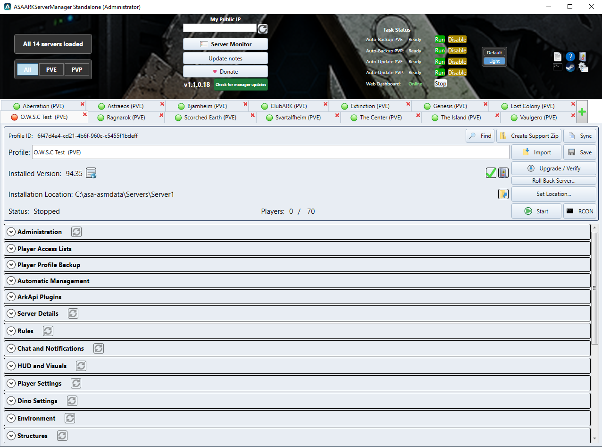
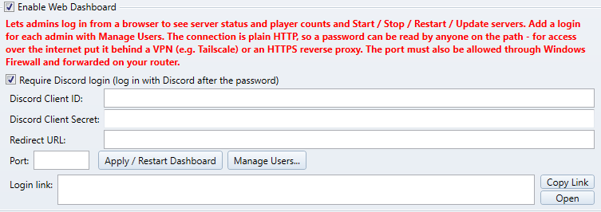
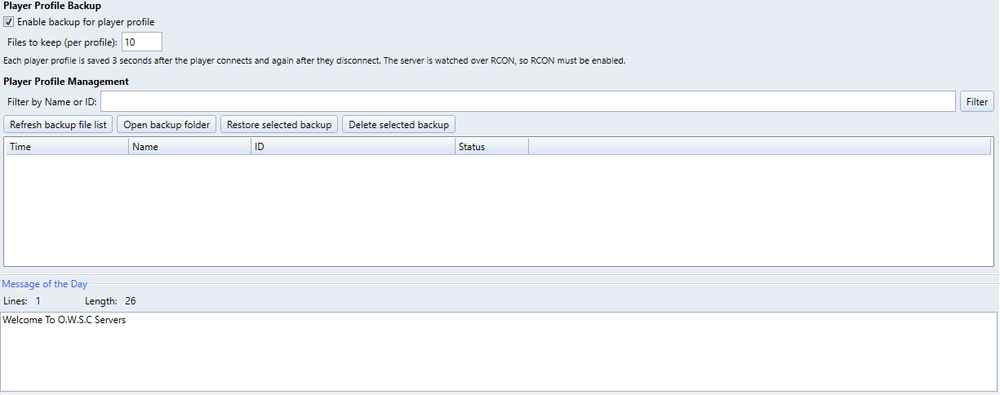

# ASEARKServerManager

A Windows server manager for **ARK: Survival Evolved** dedicated servers: profiles, settings, mods, backups, automatic
updates with a shutdown countdown, RCON, ArkApi support, a web dashboard and more. It is my ASE fork of the open-source
ARK Server Manager, brought up to date with the features of my ASA manager.

## Download

Get the newest `ASEARKServerManager-Setup-Release.exe` from the
[Releases](https://github.com/jamakenjelly/ASEARKServerManager/releases/latest) page and run it. It asks for an install folder and
makes the shortcuts. Start the manager as administrator (the shortcut does this).

The manager checks this page for a newer version by itself and shows a green bar with an Upgrade now button when there is one.

## What is in it

- Server profiles as tabs, PVE / PVP views, Task Status for Auto Backup and Auto Update, Server Monitor
- Auto Update into one shared cache, then copied to each server (mods included), with a shutdown countdown
- Backups of the map's save folder, SaveGames and the Game.ini / GameUserSettings.ini / Engine.ini files
- Player profile backup (a copy when a player connects and when they disconnect)
- ArkApi: install, update or remove it from the manager, plugins and plugin config sync
- Exclude Item Indices tick list, map spawner overrides per map, game data made from the servers' own files and mods
- Web dashboard and Discord control panel
- Default and Light looks

## Screenshots

These screenshots are from the ASA manager; the ASE manager has the same layout.

**The manager** - all server profiles as tabs, Task Status for Auto Backup / Auto Update (PVE and PVP), Server Monitor, a Check for manager updates button, Default and Light themes.

**ArkApi** - install or update the API, plugins and plugin config sync.

**Web dashboard** - status, players, CPU and RAM of every server in a browser; Start / Stop / Restart / Update, Save World, Message and Players.

Set up in Global Settings: port, a login for each admin and an optional Discord login.

**Player profile backup** - each player profile is saved when a player connects and again when they disconnect; restore or delete a backup from the list.

## Notes

- Your settings, server profiles and servers stay in your own data folder and are not touched by an install or an upgrade.
- Not an official Studio Wildcard product. ARK: Survival Evolved must be obtained separately.
- The source of the version before the ASA features were merged in is public: https://github.com/jamakenjelly/ServerManagers-source-ase-original

## Credits

This manager is built on the open-source ARK Server Manager project by its original authors and contributors:
https://github.com/Bletch1971/ServerManagers - thank you.

